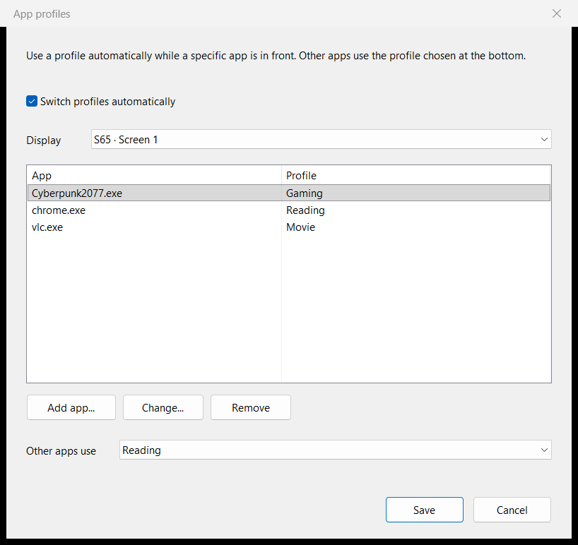
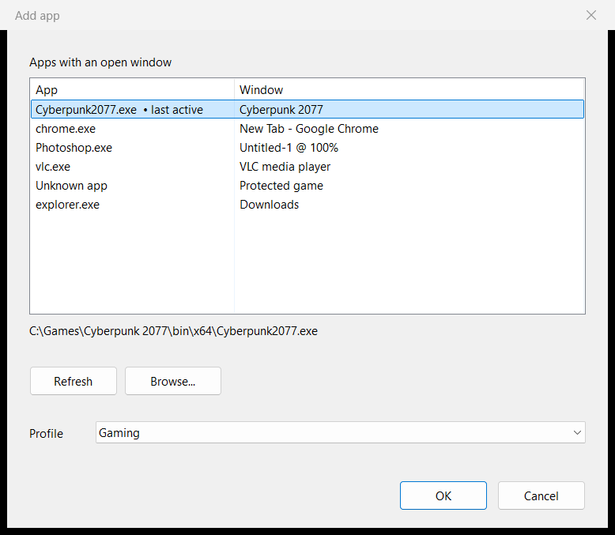

<div align="center">

# Gamma Changer

**Your display. Your profiles. A little less clicking.**

A native Windows app for gamma, brightness, contrast, and color balance.<br>
Adjust each display, save a profile, and let it follow the app in front.

[](https://github.com/Ayanamizzz/gamma-changer/releases/latest)
[](#download)
[](#build-from-source)
[](https://github.com/Ayanamizzz/gamma-changer/actions/workflows/ci.yml)

**[Download](https://github.com/Ayanamizzz/gamma-changer/releases/latest)** ·
[Screenshots](#a-look-inside) · [Getting started](#getting-started) ·
[App profiles](#app-profiles) · [Build from source](#build-from-source)

</div>

## A look inside

> **Development preview:** these screenshots and the app-profile instructions below describe the latest `main` branch. The current packaged release is **v2.6.2**, which uses the earlier interface.


<table>
  <tr>
    <th align="left">Manage apps</th>
    <th align="left">Choose an app and a profile</th>
  </tr>
  <tr>
    <td width="51%"></td>
    <td width="49%"></td>
  </tr>
  <tr>
    <td>Add, change, or remove assignments. Save together; Cancel discards the draft.</td>
    <td>Pick a running app or browse for its executable, then choose its profile.</td>
  </tr>
</table>

The app lists in the dialog screenshots use sample data.

## What it does

| Feature | In use |
| :--- | :--- |
| **Tune each display** | Gamma, brightness, contrast, and individual red, green, and blue gain. Sliders and numeric fields share the same 0.01 steps. |
| **See changes live** | A tone-response curve shows the adjustment. Changes preview live and save automatically after 0.7 seconds. |
| **Keep your profiles** | Create, rename, duplicate, and delete profiles. The sidebar shows more rows as the window gets taller. |
| **Follow your apps** | Assign a profile to an app on each display, with a separate choice for all other apps. |
| **Keep manual control** | Choosing a profile by hand pauses automatic switching. One click resumes it. |
| **Stay available** | Minimize to the tray, optionally start with Windows, and restore saved calibration after display changes or system resume. |

The interface keeps its sakura wallpaper and purple accent, with antialiased controls and Per-Monitor V2 DPI support.

## Download

**[Get the latest Windows x64 release →](https://github.com/Ayanamizzz/gamma-changer/releases/latest)**

Download the portable ZIP, extract it, and run `gamma_changer_gui.exe`. No installer or build tools are needed to run the packaged app on Windows 10 or 11.

Each release includes the ZIP, a standalone EXE, and `SHA256SUMS.txt`. To try the development interface shown above, [build from source](#build-from-source).

## Getting started

1. Choose a display in the sidebar.
2. Adjust **Tone** and **Color balance** with the sliders or numeric fields. Changes preview live and save automatically.
3. Click **+** beside **PROFILES** to create a profile. Right-click a profile to rename, duplicate, delete, or use it for an app. The Delete key also removes the focused profile.
4. Hold **Hold to compare** while an unsaved live preview is available to compare it with the previous display state. **Restore defaults** returns the selected display to a neutral LUT.

Minimizing keeps the app in the tray. Click the tray icon to reopen it, or right-click for profile and switching controls. Closing the main window exits the app.

## App profiles

Use **Gaming** for a game, **Reading** for a browser, or any saved profile you choose. The profile changes the whole display, including other visible windows.

### One switch, three states

| Switch color | State | What to do |
| :--- | :--- | :--- |
| Purple | On | Profiles follow the foreground app. |
| Gray | Off | Click **Switch automatically** to turn it on. |
| Amber | Paused after a manual profile choice or reset | Click the same switch to resume. |

The line below the switch shows the current assignment, such as `game.exe → Gaming`.

### Manage assignments

Open **Manage apps…** in the sidebar:

1. **Add app…** lists apps with an open window, with the last active app first and preselected. Choose the app and a profile, then **OK**. Use **Browse…** for an app that is not running.
2. **Change…**, or double-click a row, changes the app or its profile. **Remove**, or Delete, removes its assignment.
3. **Other apps use** chooses the desktop calibration or a saved profile for unlisted apps.
4. With multiple displays, **Display** selects the list to edit. The selector is hidden when there is only one display choice; disconnected displays retain their assignments.

Adding an app checks **Switch profiles automatically** in the draft. You can uncheck it before saving. **Save** applies the changes together; **Cancel** discards them.

For a shortcut, right-click a profile and choose **Use for an app…**. Pick the app and confirm to save that assignment directly.

<details>
<summary><strong>Matching, manual control, and older configurations</strong></summary>

- Apps match by full executable path. Two installations of the same `.exe` can use different profiles. For games, select the game executable rather than its launcher.
- If Windows prevents reading an app's location, the picker shows the error. Use **Browse…** to select the executable yourself.
- While the Gamma Changer editor is in front, switching pauses and shows the desktop calibration. Manual profile selection and restoring defaults also pause switching.
- Unlisted apps follow **Other apps use**. Choosing desktop calibration restores the exact desktop ramp captured before automatic switching. Turning switching off or exiting restores it too.
- Focus changes are coalesced over 150 ms. Returning to an app reapplies its profile because the app may have reset the display ramp.
- To adjust an app's appearance, edit its assigned profile directly. Every app using that profile shares the change; there is no separate per-app parameter editor.
- Renaming a profile keeps its assignments. Deleting one removes its assignments.
- Older configurations keep the same file format. If an app has several old rules, the list shows the effective one, or marks it off if all are disabled. Editing that app merges its rules for the selected display; untouched apps retain their existing rules.

</details>

## Display behavior and local data

At launch, the display with the largest current resolution is selected; ties prefer the Windows primary display. Refreshing keeps your selection while that display remains connected. Saved settings use stable display identities across refreshes and hot-plug events.

Profiles, assignments, captured base ramps, and diagnostic logs are stored separately from the executable:

```text
%LOCALAPPDATA%\GammaChangerCpp\
```

The app does not need an online service to adjust displays or store profiles.

**Hardware limits:** Gamma Changer adjusts the GPU's software lookup table (LUT), not the monitor's physical backlight or hardware contrast. HDR, Advanced Color, drivers, color-management software, games, and protected video can override or bypass that ramp.

## Build from source

Requires **Visual Studio 2022 Build Tools** with Desktop development with C++, a Windows 10/11 SDK, and CMake 3.21 or newer.

```powershell
.\build-release.bat
```

The script configures the project, builds the GUI and automated checks, and runs the Release tests. The app is written to `build\vs2022-x64\Release\gamma_changer_gui.exe`.

Or use CMake directly:

```powershell
cmake --preset vs2022-x64
cmake --build build\vs2022-x64 --config Release
ctest --preset release
```

CI builds Release and Debug with MSVC `/W4 /WX` and runs six CTest groups. Display-write tests use a fake backend.

<details>
<summary><strong>UI snapshots and project structure</strong></summary>

Generate PNG previews of the main window and both app dialogs:

```powershell
.\build\vs2022-x64\Release\gamma_ui_snapshot.exe .\build\snapshots
```

The tool uses temporary profile storage, a fake display backend, and sample app lists for the dialogs.

```text
assets/       Embedded wallpaper and icon
include/      Core types, services, and UI rendering helpers
src/          Calibration, persistence, runtime, and checks
src/ui/       Main window, controls, layouts, and app dialogs
src/tools/    UI snapshot utility
docs/         Screenshots, architecture proposals, and release notes
```

If rebuilding fails with `LNK1104` for the GUI executable, close the running app so Windows can replace it.

</details>

---

[Architecture](ARCHITECTURE.md) · [Release notes](docs/releases/) · [Report an issue](https://github.com/Ayanamizzz/gamma-changer/issues)
