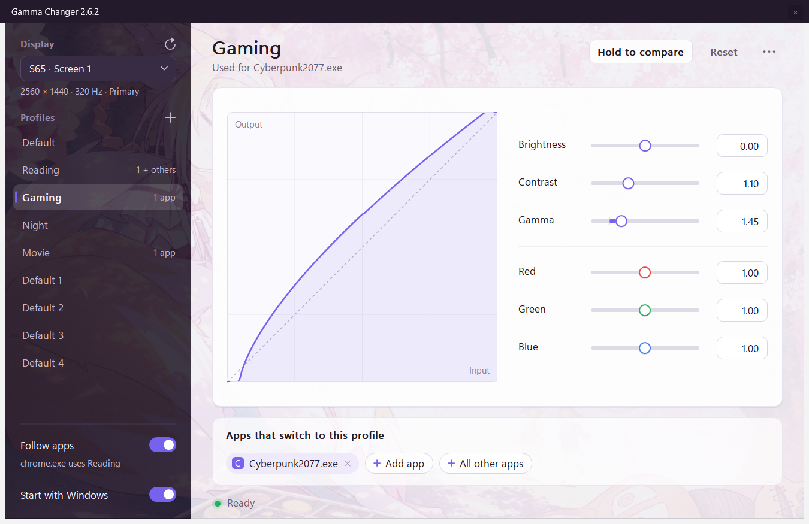
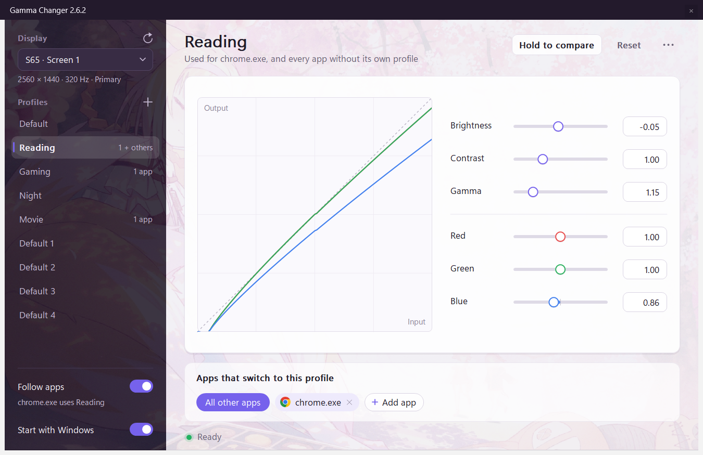

<div align="center">

# Gamma Changer

**Your display. Your profiles. A little less clicking.**

A native Windows app for gamma, brightness, contrast, and color balance.<br>
Adjust each display, save a profile, and let it follow the app in front.

[](https://github.com/Ayanamizzz/gamma-changer/releases/latest)
[](#download)
[](#build-from-source)
[](https://github.com/Ayanamizzz/gamma-changer/actions/workflows/ci.yml)

**[Download](https://github.com/Ayanamizzz/gamma-changer/releases/latest)** ·
[Screenshots](#a-look-inside) · [Getting started](#getting-started) ·
[Follow apps](#follow-apps) · [Build from source](#build-from-source)

</div>

## A look inside

> **Development preview:** these screenshots and the instructions below describe the latest `main` branch. The current packaged release is **v2.6.2**, which uses the earlier interface.



Everything happens in this one window. The profile you open fills the page: its tone curve, its six adjustments, and the apps that switch to it.



The app names in the screenshots are sample data.

## What it does

| Feature | In use |
| :--- | :--- |
| **Tune each display** | Gamma, brightness, contrast, and individual red, green, and blue gain. Sliders and numeric fields share the same 0.01 steps, and each slider fills from its neutral value, so you can see at a glance what a profile changes. |
| **See changes live** | A tone curve shows the adjustment. Changes preview live and save automatically after 0.7 seconds. |
| **Compare** | Hold **Hold to compare** to see the display without the profile; release to return. |
| **Keep your profiles** | Create, rename, duplicate, and delete profiles. The sidebar shows which apps use each one. |
| **Follow your apps** | Add an app to a profile in two clicks. One profile covers every other app. |
| **Stay available** | Minimize to the tray, optionally start with Windows, and restore saved calibration after display changes or system resume. |

The interface keeps its sakura wallpaper and purple accent, with antialiased controls and Per-Monitor V2 DPI support.

## Download

**[Get the latest Windows x64 release →](https://github.com/Ayanamizzz/gamma-changer/releases/latest)**

Download the portable ZIP, extract it, and run `gamma_changer_gui.exe`. No installer or build tools are needed to run the packaged app on Windows 10 or 11.

Each release includes the ZIP, a standalone EXE, and `SHA256SUMS.txt`. To try the development interface shown above, [build from source](#build-from-source).

## Getting started

1. Choose a display in the sidebar.
2. Click a profile to open it, then move the sliders or type a value. Changes preview live and save into the profile automatically.
3. Click **+** beside **Profiles** to create a profile and type its name. To rename one later, double-click it or press F2. The **⋯** button at the top right, or a right-click on the profile, also offers Duplicate and Delete.
4. **Hold to compare** shows the display without the profile while you hold it. **Reset** returns the open profile to neutral; Ctrl+Z undoes a reset or a profile switch.

Double-click a number to return that adjustment to neutral. Minimizing keeps the app in the tray. Click the tray icon to reopen it, or right-click it to choose how profiles are used. Closing the main window exits the app.

## Follow apps

Use **Gaming** for a game, **Reading** for a browser, or any profile you choose. A profile changes the whole display, including other visible windows.

### Give a profile its apps

1. Open the profile.
2. Click **Add app** and pick the app from the list. Apps with an open window are listed, the one you used last first. **Browse for an app…** covers anything that is not running.

That is all: the choice saves at once and **Follow apps** turns on. Each app shows as a chip on its profile. Click the cross to remove it, or click the chip to move it to another profile.

### Every other app

One profile carries the **All other apps** chip. Apps without their own profile use it. To hand it to another profile, open that profile and click **All other apps** there.

When you add your first app, Gamma Changer keeps the other apps on the profile your desktop was using, and says so in the status line.

### One switch, two states

| Follow apps | What happens |
| :--- | :--- |
| On | An app with its own profile gets that profile while it is in front. Every other app gets the **All other apps** profile. |
| Off | The selected profile is used for everything. |

The line under the switch shows what the last app you used gets, such as `chrome.exe uses Reading`.

Opening a profile to look at it or tune it does not change what your apps get. While the Gamma Changer window is in front, the display shows the open profile so you can see what you are editing.

The tray menu offers the same choice from outside the window: **Follow apps**, or **Always use** one profile. Choosing a profile there turns Follow apps off and keeps that profile until you say otherwise.

<details>
<summary><strong>Matching, displays, and older configurations</strong></summary>

- Apps match by full executable path. Two installations of the same `.exe` can use different profiles. For games, select the game executable rather than its launcher.
- If Windows prevents reading an app's location, the app is listed but cannot be picked. Use **Browse for an app…** to select the executable yourself.
- Apps and the **All other apps** profile are kept per display. The window shows the selected display; a disconnected display keeps its choices until it returns.
- Turning Follow apps off, or exiting, puts the selected profile back on the display.
- Focus changes are coalesced over 150 ms. Returning to an app reapplies its profile because the app may have reset the display ramp.
- To adjust an app's appearance, edit its profile. Every app using that profile shares the change.
- Renaming a profile keeps its apps. Deleting one removes them from it.
- Older configurations keep the same file format. If an app has several old rules, its chip follows the effective one, and a chip whose rules are all disabled is shown dimmed until you turn it on from its menu. A display that had no profile for other apps keeps using the selected profile for them, and the first time you open a different profile that choice is pinned so it no longer moves with the selection.

</details>

## Display behavior and local data

At launch, the display with the largest current resolution is selected; ties prefer the Windows primary display. Refreshing keeps your selection while that display remains connected. Saved settings use stable display identities across refreshes and hot-plug events.

Profiles, assignments, captured base ramps, and diagnostic logs are stored separately from the executable:

```text
%LOCALAPPDATA%\GammaChangerCpp\
```

The app does not need an online service to adjust displays or store profiles.

**Hardware limits:** Gamma Changer adjusts the GPU's software lookup table (LUT), not the monitor's physical backlight or hardware contrast. HDR, Advanced Color, drivers, color-management software, games, and protected video can override or bypass that ramp.

## Build from source

Requires **Visual Studio 2022 Build Tools** with Desktop development with C++, a Windows 10/11 SDK, and CMake 3.21 or newer.

```powershell
.\build-release.bat
```

The script configures the project, builds the GUI and automated checks, and runs the Release tests. The app is written to `build\vs2022-x64\Release\gamma_changer_gui.exe`.

Or use CMake directly:

```powershell
cmake --preset vs2022-x64
cmake --build build\vs2022-x64 --config Release
ctest --preset release
```

CI builds Release and Debug with MSVC `/W4 /WX` and runs six CTest groups. Display-write tests use a fake backend.

<details>
<summary><strong>UI snapshots and project structure</strong></summary>

Generate PNG previews of the main window in its main states:

```powershell
.\build\vs2022-x64\Release\gamma_ui_snapshot.exe .\build\snapshots
```

The tool uses temporary profile storage, a fake display backend, and sample app lists.

```text
assets/       Embedded wallpaper and icon
include/      Core types, services, and UI rendering helpers
src/          Calibration, persistence, runtime, and checks
src/ui/       Main window, controls, layout, painting, and app assignment
src/tools/    UI snapshot utility
docs/         Screenshots, architecture proposals, and release notes
```

If rebuilding fails with `LNK1104` for the GUI executable, close the running app so Windows can replace it.

</details>

---

[Architecture](ARCHITECTURE.md) · [Release notes](docs/releases/) · [Report an issue](https://github.com/Ayanamizzz/gamma-changer/issues)
